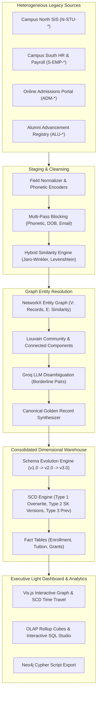

# University & Enterprise Data Warehouse Consolidation
### Data Warehouse Schema Evolution and Slowly Changing Dimensions via Graph-based Entity Resolution and Data Deduplication

An enterprise-grade academic major project implementing end-to-end multi-campus university data warehouse consolidation, featuring:
1. **Graph-Based Entity Resolution (ER) & Deduplication**: Multi-pass blocking, hybrid attribute similarity (Jaro-Winkler, Levenshtein, Phonetic Soundex/Metaphone), NetworkX entity graph modeling, and Louvain community detection.
2. **Groq LLM-Assisted Disambiguation**: High-speed semantic verification using Groq API (`openai/gpt-oss-20b`) for borderline identity matching.
3. **Automated Slowly Changing Dimensions (SCD Engine)**:
   - **SCD Type 1**: In-place overwrite for non-historical attribute corrections.
   - **SCD Type 2**: Historical tracking with Surrogate Keys, version numbering, `valid_from`, `valid_to`, `is_current` flags, and Point-in-Time / "As-Of" historical time-travel queries.
   - **SCD Type 3**: Dedicated current vs. previous column tracking for major departmental transitions.
4. **Data Warehouse Schema Evolution Engine**: Tracks schema versions (`v1.0 -> v2.0 -> v3.0`), detects schema drift, generates non-destructive DDL migrations, and logs migration audits.
5. **Interactive Executive Web Dashboard**: Clean light-themed user interface with Vis.js interactive force-directed network graph, entity cluster inspector, SCD time-travel simulator, OLAP rollup charts, and custom SQL query playground.
6. **Neo4j Production Cypher Integration**: Export graph directly into production Cypher scripts (`.cypher`) with nodes, labels, and similarity edges.

---

## 🏛️ System Architecture



---

## 🚀 Quickstart & Localhost Execution

### Prerequisites
- Python 3.10+
- Modern Web Browser (Chrome, Firefox, Edge)

### 1. Installation
Clone the repository and install required Python packages:
```bash
pip install fastapi uvicorn pandas networkx scikit-learn plotly requests jellyfish
```

### 2. Launch Localhost Server
Run the FastAPI backend server:
```bash
python -m backend.main
```
Or with Uvicorn:
```bash
uvicorn backend.main:app --host 127.0.0.1 --port 8000 --reload
```

### 3. Open Web Dashboard
Navigate your browser to:
```
http://localhost:8000
```
The dashboard automatically initializes the database on first load and runs the full entity resolution and dimensional consolidation pipeline.

---

## 🧪 Running Automated Test Suite

Run the full automated test suite verifying all 5 core modules:
```bash
python -m unittest discover -s tests -p "test_*.py"
```

---

## 📦 Directory Structure

```
uni_dwh_evolution_graph_er/
├── backend/
│   ├── api/
│   │   └── routes.py                  # FastAPI REST endpoints
│   ├── database/
│   │   ├── schema_definitions.py      # Star Schema DDLs (v1.0, v2.0, v3.0)
│   │   └── sqlite_manager.py          # SQLite connection and query pool
│   ├── services/
│   │   ├── entity_resolution/
│   │   │   ├── blocking.py            # Multi-pass blocking keys
│   │   │   ├── canonical_synthesizer.py # Precedence-based golden record synthesis
│   │   │   ├── graph_engine.py        # NetworkX Louvain clustering
│   │   │   ├── normalizer.py          # Phonetic Soundex/Metaphone cleaning
│   │   │   └── similarity.py          # Jaro-Winkler & Levenshtein metrics
│   │   ├── groq_service.py            # Groq LLM semantic reasoning
│   │   ├── neo4j_exporter.py          # Cypher DDL/DML script generation
│   │   ├── olap_engine.py             # OLAP cubes and SQL console
│   │   ├── pipeline_orchestrator.py   # Master ETL & wave orchestration
│   │   ├── scd_engine.py              # SCD 1, 2, 3 and Time-Travel engine
│   │   ├── schema_evolution_engine.py # Schema drift & migration engine
│   │   └── synthetic_data_gen.py      # Multi-campus enterprise dataset
│   ├── config.py                      # System configuration & Groq API key
│   └── main.py                        # FastAPI entrypoint
├── frontend/
│   ├── index.html                     # Light executive single-page dashboard
│   └── app.js                         # Vis.js graph, Chart.js, & REST client
├── tests/
│   └── test_consolidation_pipeline.py # Comprehensive unit & integration tests
├── data/
│   └── neo4j_graph_export.cypher      # Production Cypher script
├── PROJECT_REPORT.md                  # Comprehensive academic major project report
└── README.md                          # Documentation & user guide
```

---

## 🔑 Key Features Demonstrated

1. **Light-Themed Executive UI**:
   - Designed with soft slate, muted indigo, and pastel accents for optimal readability and zero eye strain.
   - Interactive Vis.js network graph visualizing cross-system duplicates and canonical entity clusters.
2. **Groq AI Entity Verification**:
   - Embedded prompt engineering assessing ambiguous cases with explainable rationale.
3. **Temporal Point-in-Time Querying**:
   - Real-time time-travel picker to reconstruct the exact historical university dimension state as of any date.
4. **Interactive SQL Studio**:
   - In-browser analytical query engine allowing evaluators to run queries against fact and dimension tables.
5. **Neo4j Cypher Export**:
   - One-click `.cypher` export file ready to import directly into Neo4j Browser or AuraDB.
